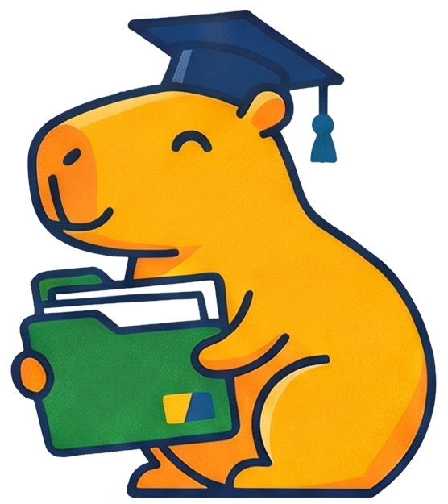

# AchievementEmblem

A 56px double-ring emblem that represents one event, certification or project medal in the "Conquistas" section.

The emblem is a filled disc (green / navy / gold by type) with an inner white ring and inner ink ring, a 24px icon in white (ink on gold). Place it at the start of a white list row with `shadow-sm`, title in Bricolage 700 17px and a meta line in `ink-muted` ("[Participação] · [Ano]"). Group rows in a tinted panel per type: Eventos on `green-tint` with a green shadow, Certificações on `navy-tint` with a navy shadow, Medalhas de projeto on `gold-tint` with a gold shadow. Unknown content stays in brackets: "[Nome do evento]".

```html
<!doctype html>
<html lang="pt-BR">
<head><meta charset="utf-8"><title>AchievementEmblem</title></head>
<body>
<div class="cf-stage" style="align-items:stretch">
<section style="flex:1 1 300px;background:var(--green-tint);border:2px solid var(--ink);border-radius:var(--radius-2xl);box-shadow:6px 6px 0 var(--green);padding:20px;display:flex;flex-direction:column;gap:12px">
<h3 style="margin:0;font:800 24px/1.05 var(--font-display);letter-spacing:-.025em;color:var(--navy)">Eventos</h3>
<div style="display:flex;align-items:center;gap:16px;background:#fff;border:2px solid var(--ink);border-radius:var(--radius-lg);padding:12px 16px;box-shadow:var(--shadow-sm)"><span class="cf-emblem evento"><svg width="24" height="24" viewBox="0 0 24 24" fill="none" stroke="#fff" stroke-width="2" stroke-linecap="round" stroke-linejoin="round" aria-hidden="true"><rect x="4" y="5" width="16" height="15" rx="2"></rect><path d="M4 10h16M9 3v4M15 3v4"></path></svg></span><div><strong style="display:block;font:700 17px/1.2 var(--font-display)">[Nome do evento]</strong><span style="font-size:14px;color:var(--ink-muted)">[Participação] · [Ano]</span></div></div>
</section>
<div style="display:flex;gap:20px;align-items:center;padding:0 12px"><span class="cf-emblem cert"><svg width="24" height="24" viewBox="0 0 24 24" fill="none" stroke="#fff" stroke-width="2" stroke-linecap="round" stroke-linejoin="round" aria-hidden="true"><circle cx="12" cy="9" r="5"></circle><path d="M9 13.5L7.5 21l4.5-2.5 4.5 2.5L15 13.5"></path></svg></span><span class="cf-emblem medalha"><svg width="24" height="24" viewBox="0 0 24 24" fill="none" stroke="#182536" stroke-width="2" stroke-linecap="round" stroke-linejoin="round" aria-hidden="true"><path d="M12 3l2.6 5.3 5.8.8-4.2 4.1 1 5.8L12 16.3 6.8 19l1-5.8L3.6 9.1l5.8-.8z"></path></svg></span></div>
</div>
</body>
</html>
```

# AchievementPill

Compact proof of an achievement type: a coloured disc with a 14px icon inside a tinted pill.

The three types are fixed and always keep their colour: **Evento** (green, calendar icon), **Certificação** (navy, rosette icon), **Medalha** (gold, star icon with an ink stroke). The label is the type name in Instrument Sans 700 13px. Use them in person-card footers and search previews; use AchievementEmblem where the achievement itself is listed.

```html
<!doctype html>
<html lang="pt-BR">
<head><meta charset="utf-8"><title>AchievementPill</title></head>
<body>
<div class="cf-stage">
<span class="cf-pill evento"><i><svg width="14" height="14" viewBox="0 0 24 24" fill="none" stroke="#fff" stroke-width="2.5" stroke-linecap="round" stroke-linejoin="round" aria-hidden="true"><rect x="4" y="5" width="16" height="15" rx="2"></rect><path d="M4 10h16M9 3v4M15 3v4"></path></svg></i>Evento</span>
<span class="cf-pill cert"><i><svg width="14" height="14" viewBox="0 0 24 24" fill="none" stroke="#fff" stroke-width="2.5" stroke-linecap="round" stroke-linejoin="round" aria-hidden="true"><circle cx="12" cy="9" r="5"></circle><path d="M9 13.5L7.5 21l4.5-2.5 4.5 2.5L15 13.5"></path></svg></i>Certificação</span>
<span class="cf-pill medalha"><i><svg width="14" height="14" viewBox="0 0 24 24" fill="none" stroke="#182536" stroke-width="2.5" stroke-linecap="round" stroke-linejoin="round" aria-hidden="true"><path d="M12 3l2.6 5.3 5.8.8-4.2 4.1 1 5.8L12 16.3 6.8 19l1-5.8L3.6 9.1l5.8-.8z"></path></svg></i>Medalha</span>
</div>
</body>
</html>
```

# Avatar

A person's photo or initials in an ink-outlined circle (or rounded square in person cards).

Sizes: 44px in the nav, 40px in comments, 56px (`avatar-md`) on post authors, 68px rounded-square (`avatar-lg`, `radius-xl`) in person cards, 280px photo (`photo-hero`, `radius-4xl`, 3px paper border, `shadow-photo`) in the portfolio hero. Without a photo show one or two initials in Bricolage 800, cycling green (white text), navy (paper text), gold (ink text). Photos are square crops with `object-fit: cover` and alt text "Foto de <nome>"; decorative initials are `aria-hidden` next to the visible name.

```html
<!doctype html>
<html lang="pt-BR">
<head><meta charset="utf-8"><title>Avatar</title></head>
<body>
<div class="cf-stage">
<span class="cf-avatar" aria-hidden="true">A</span>
<span class="cf-avatar md navy" aria-hidden="true">GC</span>
<span class="cf-avatar md" aria-hidden="true">AS</span>
<span class="cf-avatar lg gold" aria-hidden="true">M</span>
<span class="cf-avatar lg navy" aria-hidden="true">G</span>
<span class="cf-avatar lg" aria-hidden="true">N</span>
</div>
</body>
</html>
```

# Button

The outlined, hard-shadow button; pick the fill by role, not by taste.

- **primary** (navy, gold shadow): the one action a screen is for: "Entrar", "Ver portfólio", "Enviar". One per view.
- **cta** (gold, ink shadow, ink label): a highlighted creation or promotional action: "+ Publicar projeto", "Novo projeto", "Limpar filtros". Never white text on gold.
- default (white, ink shadow): secondary actions: "Nova postagem", "Entrar com Google".
- **on-navy** (transparent, paper border and shadow): secondary action on a navy hero.
- **compact**: the 46px pill used in the nav bar ("+ Publicar", "Ver demo").

Sizes: `control-md` 48px (default), `control-lg` 52px (page header), `control-xl` 56px with `.lg` (form submit, hero CTAs). Labels are Bricolage 700 17px, sentence case, verb first, in Portuguese. Icons sit after the label for navigation (arrow, external) and before it for actions (plus, heart, share).

States: hover lifts `translate(-2px,-2px)` with `shadow-hover`; active presses `translate(2px,2px)` with no shadow; focus shows a 3px `focus` outline 3px away. The consumer provides the label, optional 20px icon, and `href` when it navigates (render an `<a>`).

```html
<!doctype html>
<html lang="pt-BR">
<head><meta charset="utf-8"><title>Button</title></head>
<body>
<div class="cf-stage">
<button class="cf-btn primary" type="button">Entrar</button>
<button class="cf-btn cta" type="button">+ Publicar projeto</button>
<button class="cf-btn" type="button">Nova postagem</button>
<a class="cf-btn primary" href="#">Ver portfólio<svg width="18" height="18" viewBox="0 0 24 24" fill="none" stroke="currentColor" stroke-width="2" stroke-linecap="round" stroke-linejoin="round" aria-hidden="true"><path d="M5 12h14M13 6l6 6-6 6"></path></svg></a>
<button class="cf-btn compact primary" type="button">+ Publicar</button>
</div>
<div class="cf-stage navy" style="padding:20px 24px">
<a class="cf-btn cta lg on-navy-cta" href="#">Testar a demo<svg width="20" height="20" viewBox="0 0 24 24" fill="none" stroke="currentColor" stroke-width="2" stroke-linecap="round" stroke-linejoin="round" aria-hidden="true"><path d="M7 17L17 7M9 7h8v8"></path></svg></a>
<button class="cf-btn on-navy" type="button"><svg width="20" height="20" viewBox="0 0 24 24" fill="none" stroke="currentColor" stroke-width="2" stroke-linecap="round" stroke-linejoin="round" aria-hidden="true"><circle cx="6" cy="12" r="2.5"></circle><circle cx="18" cy="6" r="2.5"></circle><circle cx="18" cy="18" r="2.5"></circle><path d="M8.2 11l7.6-3.8M8.2 13l7.6 3.8"></path></svg>Compartilhar portfólio</button>
</div>
</body>
</html>
```

# Card

The outlined white panel with a coloured hard shadow: the default container for content.

White surface, 2px ink outline, `radius-2xl`, padding `space-7`–`space-8`. Colour the shadow by role: `shadow-card` (navy) for main content (posts, project info, filters); `.green` for forms and success (login card); `.gold` on `gold-tint` for highlight sidebars ("Projetos em destaque"); `.cta` gold fill with an ink shadow for a single prompt ("Compartilhe seu projeto"); `.dashed` with no shadow for placeholders and empty states. Card titles are Bricolage 800 24–26px in `navy` (ink on gold). Do not nest shadowed cards in shadowed cards more than one level; inner rows use `shadow-sm`.

```html
<!doctype html>
<html lang="pt-BR">
<head><meta charset="utf-8"><title>Card</title></head>
<body>
<div class="cf-stage" style="align-items:stretch;gap:28px;padding:24px 32px 32px 24px">
<div class="cf-card" style="flex:1 1 200px"><h3>Informações do projeto</h3><p>Navy shadow: main content.</p></div>
<div class="cf-card green" style="flex:1 1 200px"><h3>Entrar na sua conta</h3><p>Green shadow: forms and success.</p></div>
<div class="cf-card gold" style="flex:1 1 200px"><h3>Projetos em destaque</h3><p>Gold tint: highlights.</p></div>
<div class="cf-card cta" style="flex:1 1 200px"><h3>Compartilhe seu projeto</h3><p>Divulgue sua pesquisa e inspire outros estudantes.</p></div>
</div>
</body>
</html>
```

# Comment

A reply under a post: green-tinted bubble with a 40px avatar, name, relative time and text.

Name Bricolage 700 17px, time "Há 1 hora" in 14px `ink-muted` on the right, text 16px/1.5. Below the comments, a reply form: TextField at 48px ("Responder como <nome>") plus a primary "Enviar" button.

```html
<!doctype html>
<html lang="pt-BR">
<head><meta charset="utf-8"><title>Comment</title></head>
<body>
<div class="cf-stage col" style="max-width:640px"><div class="cf-comment"><span class="cf-avatar" style="width:40px;height:40px;font-size:15px" aria-hidden="true">AS</span><div style="flex:1;min-width:0;display:flex;flex-direction:column;gap:4px"><div style="display:flex;justify-content:space-between;gap:12px"><strong>Ana Clara Souza</strong><time>Há 1 hora</time></div><span style="font-size:16px;line-height:1.5">Excelente trabalho, Gabriel e Mariana! A visualização espacial ficou super clara e muito bem documentada.</span></div></div></div>
</body>
</html>
```

# EmptyState

A dashed-outline panel that says nothing matched and offers the one way out.

Title Bricolage 800 28px in `navy` stating the situation ("Nenhum perfil com esses filtros"), one sentence of guidance in `ink-muted`, then a single gold `cta` button ("Limpar filtros"). Same dashed treatment (on `gold-tint`) marks placeholder content still to be supplied, e.g. "[Tamanho do mercado]".

```html
<!doctype html>
<html lang="pt-BR">
<head><meta charset="utf-8"><title>EmptyState</title></head>
<body>
<div class="cf-stage col"><div class="cf-empty"><h3>Nenhum perfil com esses filtros</h3><p>Remova algum filtro ou busque por outra especialidade para ver mais estudantes.</p><button class="cf-btn cta" type="button">Limpar filtros</button></div></div>
</body>
</html>
```

# FeatureRow

A paper-coloured row with a 44px icon tile, a Bricolage title and one line of description, used to list value props on navy.

Each row takes one shadow colour in order: gold, green, navy-tint, with the icon tile in the matching tint. Titles are single imperative words ("Descubra", "Compartilhe", "Conecte-se"); descriptions one short sentence in `ink-muted`. Stack three at most, `space-3_5` apart, max 380–440px wide.

```html
<!doctype html>
<html lang="pt-BR">
<head><meta charset="utf-8"><title>FeatureRow</title></head>
<body>
<div class="cf-stage col navy" style="max-width:440px;gap:14px">
<div class="cf-feature"><span class="ic"><svg width="22" height="22" viewBox="0 0 24 24" fill="none" stroke="#182536" stroke-width="2" stroke-linecap="round" stroke-linejoin="round" aria-hidden="true"><circle cx="11" cy="11" r="7"></circle><path d="M20 20l-4-4"></path></svg></span><div><strong>Descubra</strong><span>Projetos de diversas áreas e instituições.</span></div></div>
<div class="cf-feature green"><span class="ic"><svg width="22" height="22" viewBox="0 0 24 24" fill="none" stroke="#182536" stroke-width="2" stroke-linecap="round" stroke-linejoin="round" aria-hidden="true"><path d="M4 12v7a1 1 0 001 1h14a1 1 0 001-1v-7"></path><path d="M12 16V4M7 9l5-5 5 5"></path></svg></span><div><strong>Compartilhe</strong><span>Seus trabalhos e conquistas acadêmicas.</span></div></div>
<div class="cf-feature tint"><span class="ic"><svg width="22" height="22" viewBox="0 0 24 24" fill="none" stroke="#182536" stroke-width="2" stroke-linecap="round" stroke-linejoin="round" aria-hidden="true"><path d="M4 5h16v11H9l-5 4z"></path></svg></span><div><strong>Conecte-se</strong><span>Com pesquisadores, estudantes e instituições.</span></div></div>
</div>
</body>
</html>
```

# FilterChip

A toggle chip for multi-select filters (Especialidades) and the removable chip that echoes an active filter.

Toggle chips are 40px white pills with an ink outline; pressed (`aria-pressed="true"`) they fill `gold` with a 2px ink shadow. Within a group, chips combine with OR; across groups, AND. Active filters repeat above the results as removable chips on `gold-tint` with a small ✕ icon and `aria-label="Remover filtro React"`. Labels are the skill's own name (React, Node.js, Python, LLMs).

```html
<!doctype html>
<html lang="pt-BR">
<head><meta charset="utf-8"><title>FilterChip</title></head>
<body>
<div class="cf-stage">
<button class="cf-chip" type="button" aria-pressed="true">React</button>
<button class="cf-chip" type="button" aria-pressed="false">Node.js</button>
<button class="cf-chip" type="button" aria-pressed="true">Python</button>
<button class="cf-chip" type="button" aria-pressed="false">LLMs</button>
</div>
<div class="cf-stage" style="padding-top:0">
<button class="cf-chip removable" type="button" aria-label="Remover filtro React">React<svg width="14" height="14" viewBox="0 0 24 24" fill="none" stroke="#182536" stroke-width="3" stroke-linecap="round" stroke-linejoin="round" aria-hidden="true"><path d="M6 6l12 12M18 6L6 18"></path></svg></button>
<button class="cf-chip removable" type="button" aria-label="Remover filtro Pronto p/ Mercado">Pronto p/ Mercado<svg width="14" height="14" viewBox="0 0 24 24" fill="none" stroke="#182536" stroke-width="3" stroke-linecap="round" stroke-linejoin="round" aria-hidden="true"><path d="M6 6l12 12M18 6L6 18"></path></svg></button>
</div>
</body>
</html>
```

# FilterOption

A 44px checkbox row with its option label and a live count, grouped under a Bricolage legend.

Use inside a `<fieldset>` whose `<legend>` is Bricolage 700 18px ("Curso", "Instituição", "Período", "Conquistas", "Perfil"). The checkbox is 22px with `accent-color: navy`; the count is 14px `ink-muted`, right-aligned, and shows how many profiles match that option. The consumer provides label, count and checked state.

```html
<!doctype html>
<html lang="pt-BR">
<head><meta charset="utf-8"><title>FilterOption</title></head>
<body>
<div class="cf-stage col" style="max-width:320px;background:#fff">
<fieldset style="border:0;margin:0;padding:0"><legend style="padding:0;margin-bottom:6px;font:700 18px var(--font-display)">Conquistas</legend>
<label class="cf-check"><input type="checkbox" checked><span>Eventos</span><span class="n">4</span></label>
<label class="cf-check"><input type="checkbox"><span>Certificações</span><span class="n">4</span></label>
<label class="cf-check"><input type="checkbox"><span>Medalhas de projeto</span><span class="n">3</span></label>
</fieldset></div>
</body>
</html>
```

# HeroBlock

The navy band with the paper dot grid that opens every page: breadcrumb or eyebrow, big headline, one paragraph, then the page's main control.

Background `navy` with `radial-gradient(dot-grid 1.5px, transparent 1.5px)` at `dot-pitch` (26px), 2px ink bottom edge, inner width `content-max` with `space-12` gutters. Headline Bricolage 800 (`display`, 68px, up to `display-xl` for a person's name) in `on-navy`, balanced wrap; supporting copy 19px `on-navy-muted`, max 56–62ch. Links and subtitles on navy are `gold-light`. Content below may overlap the hero's bottom by `space-14` (stat tiles). The mascot appears on navy only inside a MascotDisc.

```html
<!doctype html>
<html lang="pt-BR">
<head><meta charset="utf-8"><title>HeroBlock</title></head>
<body>
<section class="cf-hero" style="padding:32px 48px 40px">
<nav class="cf-crumbs" aria-label="Trilha"><a href="#">Projetos</a><span aria-hidden="true">/</span><span>Busca</span></nav>
<h1>Encontre estudantes pelo que já construíram</h1>
<p>Filtre por especialidade, curso, instituição e conquistas. Cada resultado leva ao portfólio completo.</p>
</section>
</body>
</html>
```

# IconButton

Round 44px outlined button for a single icon, and the pill counter for reactions.

Use `.cf-icon-btn` for icon-only actions in the nav (Notificações) and always give it an `aria-label`. Use `.cf-counter` for like and comment counts on a post: icon plus number, `aria-label` with the full phrase ("Curtir, 54 curtidas"); a liked state fills with `gold-tint`. Icons are 20px line icons, stroke 2, in `ink`.

```html
<!doctype html>
<html lang="pt-BR">
<head><meta charset="utf-8"><title>IconButton</title></head>
<body>
<div class="cf-stage">
<button class="cf-icon-btn" type="button" aria-label="Notificações"><svg width="20" height="20" viewBox="0 0 24 24" fill="none" stroke="currentColor" stroke-width="2" stroke-linecap="round" stroke-linejoin="round" aria-hidden="true"><path d="M6 9a6 6 0 0112 0c0 6 2 7 2 7H4s2-1 2-7"></path><path d="M10 20a2 2 0 004 0"></path></svg></button>
<button class="cf-icon-btn" type="button" aria-label="Fechar"><svg width="20" height="20" viewBox="0 0 24 24" fill="none" stroke="currentColor" stroke-width="2" stroke-linecap="round" stroke-linejoin="round" aria-hidden="true"><path d="M6 6l12 12M18 6L6 18"></path></svg></button>
<button class="cf-counter liked" type="button" aria-label="Curtir, 54 curtidas"><svg width="20" height="20" viewBox="0 0 24 24" fill="none" stroke="currentColor" stroke-width="2" stroke-linecap="round" stroke-linejoin="round" aria-hidden="true"><path d="M12 20s-8-5-8-11a4.5 4.5 0 018-2.8A4.5 4.5 0 0120 9c0 6-8 11-8 11z"></path></svg>54</button>
<button class="cf-counter" type="button" aria-label="Comentários, 1"><svg width="20" height="20" viewBox="0 0 24 24" fill="none" stroke="currentColor" stroke-width="2" stroke-linecap="round" stroke-linejoin="round" aria-hidden="true"><path d="M4 5h16v11H9l-5 4z"></path></svg>1</button>
</div>
</body>
</html>
```

# InfoList

A definition list of facts, each with a 44px tinted icon tile: label in `ink-muted` 14px, value in 700 16px.

Use inside a Card ("Informações do projeto") for Instituição, Área de conhecimento, Tipo, Período. Cycle the tile tints navy-tint, green-tint, gold-tint. Mark up as `<dl>` with `<dt>`/`<dd>`; icons are decorative.

```html
<!doctype html>
<html lang="pt-BR">
<head><meta charset="utf-8"><title>InfoList</title></head>
<body>
<div class="cf-stage"><section class="cf-card" style="max-width:400px;flex:1"><h3>Informações do projeto</h3>
<dl class="cf-info">
<div><span class="ic" style="background:var(--navy-tint)" aria-hidden="true"><svg width="22" height="22" viewBox="0 0 24 24" fill="none" stroke="#182536" stroke-width="2" stroke-linecap="round" stroke-linejoin="round" aria-hidden="true"><path d="M3 10l9-6 9 6M5 10v9M19 10v9M9 10v9M15 10v9M3 20h18"></path></svg></span><div><dt>Instituição</dt><dd>Universidade Federal Fluminense (UFF)</dd></div></div>
<div><span class="ic" style="background:var(--green-tint)" aria-hidden="true"><svg width="22" height="22" viewBox="0 0 24 24" fill="none" stroke="#182536" stroke-width="2" stroke-linecap="round" stroke-linejoin="round" aria-hidden="true"><ellipse cx="12" cy="6" rx="7" ry="3"></ellipse><path d="M5 6v6c0 1.7 3 3 7 3s7-1.3 7-3V6M5 12v6c0 1.7 3 3 7 3s7-1.3 7-3v-6"></path></svg></span><div><dt>Área de conhecimento</dt><dd>Dados e Análise</dd></div></div>
<div><span class="ic" style="background:var(--gold-tint)" aria-hidden="true"><svg width="22" height="22" viewBox="0 0 24 24" fill="none" stroke="#182536" stroke-width="2" stroke-linecap="round" stroke-linejoin="round" aria-hidden="true"><path d="M6 3h9l4 4v14H6zM14 3v5h5"></path></svg></span><div><dt>Tipo</dt><dd>Projeto de pesquisa</dd></div></div>
</dl></section></div>
</body>
</html>
```

# MascotDisc

The capybara mascot always sits on an off-white disc: its dark outline disappears on navy.

`paper` circle, 2px ink outline, `shadow-card-gold`, the mascot PNG (`assets/Logos/capy-mascot.png`) bottom-aligned at about 75–80% of the disc and slightly cropped by it. Sizes: 300–360px in heroes, 120px in previews, 44px in the footer. Pair it with at most one Sticker. Alt text: "Capivara com capelo de formatura abraçando uma pasta verde" when it carries meaning, empty otherwise.

```html
<!doctype html>
<html lang="pt-BR">
<head><meta charset="utf-8"><title>MascotDisc</title></head>
<body>
<div class="cf-stage navy" style="padding:24px 40px 36px;gap:0;position:relative">
<div class="cf-disc"></div>
<span class="cf-sticker" style="position:relative;left:-60px;top:90px">Grandes ideias também nascem na universidade.</span>
</div>
</body>
</html>
```

# NavBar

The white top bar on every signed-in screen: brand, five sections, search, publish, notifications, avatar.

Order is fixed: brand (mascot 36px + live-text wordmark "Capy" in `navy`, "Folio" in `green`), nav links **Projetos · Pessoas · Feed · Eventos · Meu Portfólio**, the search pill (flexes to fill), then "+ Publicar" (compact primary), the notifications icon button and the user's avatar. The current page's link carries `aria-current="page"` and becomes a gold pill with an ink border. Bottom edge is a 2px `ink` rule; padding `space-3` × `space-12`.

On the Busca page the search pill is omitted so the hero search is the only one. The consumer provides the active section, the user's photo or initial, and link targets.

```html
<!doctype html>
<html lang="pt-BR">
<head><meta charset="utf-8"><title>NavBar</title></head>
<body>
<header class="cf-nav">
<div class="cf-brand"><b>Capy<em>Folio</em></b></div>
<nav aria-label="Principal"><a href="#">Projetos</a><a href="#">Pessoas</a><a href="#" aria-current="page">Feed</a><a href="#">Eventos</a><a href="#">Meu Portfólio</a></nav>
<div class="cf-search" style="flex:1 1 200px;min-width:0"><svg width="20" height="20" viewBox="0 0 24 24" fill="none" stroke="#56616D" stroke-width="2" stroke-linecap="round" stroke-linejoin="round" aria-hidden="true"><circle cx="11" cy="11" r="7"></circle><path d="M20 20l-4-4"></path></svg><input aria-label="Buscar" placeholder="Buscar projetos, pessoas, instituições…"></div>
<div style="display:flex;align-items:center;gap:12px"><button class="cf-btn compact primary" type="button">+ Publicar</button><button class="cf-icon-btn" type="button" aria-label="Notificações"><svg width="20" height="20" viewBox="0 0 24 24" fill="none" stroke="currentColor" stroke-width="2" stroke-linecap="round" stroke-linejoin="round" aria-hidden="true"><path d="M6 9a6 6 0 0112 0c0 6 2 7 2 7H4s2-1 2-7"></path><path d="M10 20a2 2 0 004 0"></path></svg></button><span class="cf-avatar" aria-label="Arthur">A</span></div>
</header>
</body>
</html>
```

# PersonCard

A search result for a student: avatar, name, role, course, skills, achievements and a "Ver portfólio" button.

Top row: 68px square avatar, name (Bricolage 800 24px), role in `green` 700 16px, connection count right-aligned in `ink-muted`. Then course (bold) and "período · instituição". Skills as `skill` tags, gold when they match an active filter. A `line` rule, then AchievementPills and, when true, "Pronto p/ Mercado" in `green-ink`. The full-width primary button links to the portfolio. Shadows cycle green, gold, navy, ink across a grid (`minmax(360px,1fr)`). Never invent people; unknown entries stay as "[Nome do estudante]".

```html
<!doctype html>
<html lang="pt-BR">
<head><meta charset="utf-8"><title>PersonCard</title></head>
<body>
<div class="cf-stage" style="align-items:flex-start;padding-bottom:32px"><article class="cf-person" style="box-shadow:5px 5px 0 var(--green);flex:1">
<div style="display:flex;gap:16px;align-items:center"><span class="cf-avatar lg navy" aria-hidden="true">M</span><div style="flex:1;min-width:0"><h3>Mariana Alves</h3><span class="role">Análise de dados</span></div><span style="font-size:14px;color:var(--ink-muted)">97 conexões</span></div>
<div style="font-size:16px"><strong>Estatística</strong><br><span style="color:var(--ink-muted)">6º período · UFF</span></div>
<div style="display:flex;flex-wrap:wrap;gap:8px"><span class="cf-tag skill match">Python</span><span class="cf-tag skill">GeoPandas</span><span class="cf-tag skill">PostgreSQL</span></div>
<div class="foot"><span class="cf-pill cert"><i><svg width="14" height="14" viewBox="0 0 24 24" fill="none" stroke="#fff" stroke-width="2.5" stroke-linecap="round" stroke-linejoin="round" aria-hidden="true"><circle cx="12" cy="9" r="5"></circle><path d="M9 13.5L7.5 21l4.5-2.5 4.5 2.5L15 13.5"></path></svg></i>Certificação</span><span class="cf-pill medalha"><i><svg width="14" height="14" viewBox="0 0 24 24" fill="none" stroke="#182536" stroke-width="2.5" stroke-linecap="round" stroke-linejoin="round" aria-hidden="true"><path d="M12 3l2.6 5.3 5.8.8-4.2 4.1 1 5.8L12 16.3 6.8 19l1-5.8L3.6 9.1l5.8-.8z"></path></svg></i>Medalha</span><span style="margin-left:auto;font-weight:700;font-size:13px;color:var(--green-ink)">Pronto p/ Mercado</span></div>
<a class="cf-btn primary block" href="#">Ver portfólio<svg width="18" height="18" viewBox="0 0 24 24" fill="none" stroke="currentColor" stroke-width="2" stroke-linecap="round" stroke-linejoin="round" aria-hidden="true"><path d="M5 12h14M13 6l6 6-6 6"></path></svg></a>
</article></div>
</body>
</html>
```

# PricingCard

A plan card: audience name, big price, "por mês", and three green-checked benefits.

Price in Bricolage 800 56px `navy` with tabular numbers, Brazilian format ("R$ 27,90"). Students' plan takes a gold shadow, companies' a navy one (8px). Benefits are one line each, 17px, with a 22px green check. Keep to two plans side by side.

```html
<!doctype html>
<html lang="pt-BR">
<head><meta charset="utf-8"><title>PricingCard</title></head>
<body>
<div class="cf-stage" style="padding-bottom:32px"><div class="cf-price" style="box-shadow:8px 8px 0 var(--gold);max-width:420px;flex:1">
<div><h3 style="margin:0;font:800 26px/1.1 var(--font-display)">Estudantes</h3><div style="display:flex;align-items:baseline;gap:8px;margin-top:6px"><span class="amt">R$ 27,90</span><span class="per">por mês</span></div></div>
<div class="cf-li"><svg width="22" height="22" viewBox="0 0 24 24" fill="none" stroke="#1B8243" stroke-width="2.8" stroke-linecap="round" stroke-linejoin="round" aria-hidden="true"><path d="M5 12l5 5L20 7"></path></svg><span>Portfólio público com projetos e conquistas.</span></div>
<div class="cf-li"><svg width="22" height="22" viewBox="0 0 24 24" fill="none" stroke="#1B8243" stroke-width="2.8" stroke-linecap="round" stroke-linejoin="round" aria-hidden="true"><path d="M5 12l5 5L20 7"></path></svg><span>Selos de eventos, certificações e medalhas de projeto.</span></div>
<div class="cf-li"><svg width="22" height="22" viewBox="0 0 24 24" fill="none" stroke="#1B8243" stroke-width="2.8" stroke-linecap="round" stroke-linejoin="round" aria-hidden="true"><path d="M5 12l5 5L20 7"></path></svg><span>Feed e conexões com outros estudantes.</span></div>
</div></div>
</body>
</html>
```

# ProjectTile

A clickable project summary in a grid: status tag, title, two-line summary, "Ver projeto →".

White, ink outline, `radius-xl`, `shadow-md`, min 200px tall, padding `space-5`; hover lifts. Title Bricolage 700 21px, summary 15px `ink-muted`, link text 700 15px `navy` pinned to the bottom. A featured project can add "Destaque" in `green-ink` on the right of the tag row. For the single featured project use a wide Card (`radius-3xl`, 10px green shadow) with a gold dotted cover and the icon in a paper tile. The last grid cell may be an "Adicionar projeto" link in `green`.

```html
<!doctype html>
<html lang="pt-BR">
<head><meta charset="utf-8"><title>ProjectTile</title></head>
<body>
<div class="cf-stage" style="align-items:stretch;padding-bottom:30px">
<a class="cf-project" href="#" style="flex:1 1 240px"><div style="display:flex;justify-content:space-between;align-items:center"><span class="cf-tag done" style="font-size:13px;padding:4px 12px">Concluído</span><span style="font-weight:700;font-size:14px;color:var(--green-ink)">Destaque</span></div><strong>Plataforma de Otimização de Processos Tech com LLMs</strong><span class="sum">[Resumo do projeto]</span><span class="go">Ver projeto<svg width="18" height="18" viewBox="0 0 24 24" fill="none" stroke="currentColor" stroke-width="2" stroke-linecap="round" stroke-linejoin="round" aria-hidden="true"><path d="M5 12h14M13 6l6 6-6 6"></path></svg></span></a>
<a class="cf-project" href="#" style="flex:1 1 240px"><div><span class="cf-tag progress" style="font-size:13px;padding:4px 12px">Em andamento</span></div><strong>[Título do projeto]</strong><span class="sum">[Resumo do projeto]</span><span class="go">Ver projeto<svg width="18" height="18" viewBox="0 0 24 24" fill="none" stroke="currentColor" stroke-width="2" stroke-linecap="round" stroke-linejoin="round" aria-hidden="true"><path d="M5 12h14M13 6l6 6-6 6"></path></svg></span></a>
</div>
</body>
</html>
```

# ResultItem

A green-tinted list row with a round check mark, for outcomes and confirmed facts ("Principais resultados").

Row: `green-tint`, ink outline, `radius-lg`, 4px green hard shadow, Instrument Sans 500 17px. The 30px check disc is `green` with a white check. Write each item as one complete sentence ending in a period. For "before / after" comparisons, use the same check in `green` against an ✕ in `ink-muted` without the tinted row.

```html
<!doctype html>
<html lang="pt-BR">
<head><meta charset="utf-8"><title>ResultItem</title></head>
<body>
<ul class="cf-stage col" style="list-style:none;margin:0;max-width:600px;gap:12px">
<li class="cf-result"><i><svg width="16" height="16" viewBox="0 0 24 24" fill="none" stroke="#fff" stroke-width="3.5" stroke-linecap="round" stroke-linejoin="round" aria-hidden="true"><path d="M5 12l5 5L20 7"></path></svg></i>Mapeamento da distribuição de poluentes na cidade.</li>
<li class="cf-result"><i><svg width="16" height="16" viewBox="0 0 24 24" fill="none" stroke="#fff" stroke-width="3.5" stroke-linecap="round" stroke-linejoin="round" aria-hidden="true"><path d="M5 12l5 5L20 7"></path></svg></i>Identificação de áreas críticas de maior concentração.</li>
<li class="cf-result"><i><svg width="16" height="16" viewBox="0 0 24 24" fill="none" stroke="#fff" stroke-width="3.5" stroke-linecap="round" stroke-linejoin="round" aria-hidden="true"><path d="M5 12l5 5L20 7"></path></svg></i>Análise temporal das variações de qualidade do ar.</li>
</ul>
</body>
</html>
```

# SearchField

Two search inputs: the 46px pill in the nav bar, and the 60px hero search with a gold hard shadow on navy.

The nav pill sits on `paper` inside the white bar; placeholder "Buscar projetos, pessoas, instituições…". The hero search sits on a navy HeroBlock, white with `radius-lg` and a 5px gold shadow; placeholder "Busque por nome, área ou tecnologia". Both start with a 20–24px search icon in `ink-muted`. Wrap the hero search in `<form role="search">` and give it a visually hidden label. The consumer provides the value and change handler; results update live.

```html
<!doctype html>
<html lang="pt-BR">
<head><meta charset="utf-8"><title>SearchField</title></head>
<body>
<div class="cf-stage col" style="background:#fff">
<div class="cf-search"><svg width="20" height="20" viewBox="0 0 24 24" fill="none" stroke="#56616D" stroke-width="2" stroke-linecap="round" stroke-linejoin="round" aria-hidden="true"><circle cx="11" cy="11" r="7"></circle><path d="M20 20l-4-4"></path></svg><input aria-label="Buscar" placeholder="Buscar projetos, pessoas, instituições…"></div>
</div>
<div class="cf-stage col navy">
<div class="cf-search hero"><svg width="24" height="24" viewBox="0 0 24 24" fill="none" stroke="#56616D" stroke-width="2" stroke-linecap="round" stroke-linejoin="round" aria-hidden="true"><circle cx="11" cy="11" r="7"></circle><path d="M20 20l-4-4"></path></svg><input aria-label="Buscar por nome, área ou tecnologia" placeholder="Busque por nome, área ou tecnologia"></div>
</div>
</body>
</html>
```

# StatTile

A white tile with a small label over a big Bricolage value, shadow coloured per tile.

Use in a row of three or four that overlaps the bottom of a navy hero by `space-14` (portfolio: Curso, Período, Conexões; investors: key numbers). Each tile in a row takes a different shadow: green, gold, navy, ink. Label 15px `ink-muted` on top for profile facts; for key numbers (`.big`) the 36px navy value comes first and the label explains it below. Never invent numbers to fill a tile.

```html
<!doctype html>
<html lang="pt-BR">
<head><meta charset="utf-8"><title>StatTile</title></head>
<body>
<div class="cf-stage" style="align-items:stretch">
<div class="cf-stat" style="box-shadow:5px 5px 0 var(--green)"><span>Curso</span><strong>Engenharia de Software</strong></div>
<div class="cf-stat" style="box-shadow:5px 5px 0 var(--gold)"><span>Período</span><strong>7º Período</strong></div>
<div class="cf-stat" style="box-shadow:5px 5px 0 var(--navy)"><span>Conexões</span><strong>88</strong></div>
</div>
</body>
</html>
```

# Sticker

The rotated gold note: the one playful accent and the only orchestrated motion.

A gold label with an ink outline, `radius-sm`, Bricolage 700 17px, rotated −4° to −5° and overlapping a hero element (the mascot disc or a stat). It enters once with the `rise` keyframe (0.7s, `.cf-pop`), skipped under `prefers-reduced-motion`. One sticker per screen, a short statement ("Grandes ideias também nascem na universidade.", "App no ar em ago/2027"). Never put links or buttons in it.

```html
<!doctype html>
<html lang="pt-BR">
<head><meta charset="utf-8"><title>Sticker</title></head>
<body>
<div class="cf-stage navy" style="padding:32px 40px"><span class="cf-sticker cf-pop">Grandes ideias também nascem na universidade.</span></div>
</body>
</html>
```

# Tabs

Folder-style tabs that sit on a 2px ink baseline; the selected tab is a white tab with an ink outline open at the bottom.

Labels are Instrument Sans 700 17px, one or two words ("Visão geral", "Metodologia", "Resultados", "Arquivos", "Autores"). Use `role="tablist"`/`role="tab"` with `aria-selected`. The row scrolls horizontally on narrow screens rather than wrapping. For segmented choices inside a card (scenario pickers), use FilterChip instead.

```html
<!doctype html>
<html lang="pt-BR">
<head><meta charset="utf-8"><title>Tabs</title></head>
<body>
<div style="padding:24px 24px 0"><div class="cf-tabs" role="tablist" aria-label="Seções do projeto">
<a class="cf-tab" href="#" role="tab" aria-selected="true">Visão geral</a><a class="cf-tab" href="#" role="tab" aria-selected="false">Metodologia</a><a class="cf-tab" href="#" role="tab" aria-selected="false">Resultados</a><a class="cf-tab" href="#" role="tab" aria-selected="false">Arquivos</a><a class="cf-tab" href="#" role="tab" aria-selected="false">Autores</a>
</div></div>
</body>
</html>
```

# Tag

Small pills that label a thing: knowledge area, project status, skill.

- **topic** (`navy-tint`, navy text and border): knowledge area, e.g. "Dados e Análise".
- **done** (`green-tint`): status "Concluído". **progress** (`gold-tint` with a green dot): "Em andamento". **featured** (`gold`): "Destaque".
- **skill** (`paper`, `line` border): a technology in a person card; when it matches an active filter it switches to `gold` with an ink border.
- **on-navy** (transparent, paper outline): specialties inside the navy portfolio hero.

Text is Instrument Sans 700 14px. Tags are not interactive; for toggles use FilterChip.

```html
<!doctype html>
<html lang="pt-BR">
<head><meta charset="utf-8"><title>Tag</title></head>
<body>
<div class="cf-stage">
<span class="cf-tag topic">Dados e Análise</span>
<span class="cf-tag done">Concluído</span>
<span class="cf-tag progress">Em andamento</span>
<span class="cf-tag featured">Destaque</span>
<span class="cf-tag skill match">Python</span>
<span class="cf-tag skill">GeoPandas</span>
<span class="cf-tag skill">PostgreSQL</span>
</div>
<div class="cf-stage navy" style="padding:16px 24px"><span class="cf-tag on-navy">React</span><span class="cf-tag on-navy">TypeScript</span><span class="cf-tag on-navy">LLMs</span></div>
</body>
</html>
```

# TextField

Label above a 52px input with a `field-border` outline that turns `navy` with a gold hard shadow on focus.

Labels are Instrument Sans 700 15px, sentence case ("E-mail", "Senha"); placeholders show an example in `placeholder` ("seu@email.com", "Digite sua senha"). A password field carries a 44px "Mostrar senha" eye button inside its right edge. Inline reply fields ("Responder como Arthur") use the same input at 48px next to a primary button. The consumer provides `id`/`for`, type, placeholder and any error text (write errors in `ink` next to the field, never in gold).

```html
<!doctype html>
<html lang="pt-BR">
<head><meta charset="utf-8"><title>TextField</title></head>
<body>
<div class="cf-stage col" style="max-width:420px">
<div class="cf-field"><label for="e">E-mail</label><input class="cf-input" id="e" type="email" placeholder="seu@email.com"></div>
<div class="cf-field"><label for="s">Senha</label><div style="position:relative"><input class="cf-input is-focus" id="s" type="password" value="capivara" style="padding-right:52px"><button type="button" aria-label="Mostrar senha" style="position:absolute;right:4px;top:4px;width:44px;height:44px;border:0;background:transparent;display:flex;align-items:center;justify-content:center;cursor:pointer"><svg width="22" height="22" viewBox="0 0 24 24" fill="none" stroke="#56616D" stroke-width="2" stroke-linecap="round" stroke-linejoin="round" aria-hidden="true"><path d="M2 12s4-7 10-7 10 7 10 7-4 7-10 7S2 12 2 12z"></path><circle cx="12" cy="12" r="3"></circle></svg></button></div></div>
</div>
</body>
</html>
```

